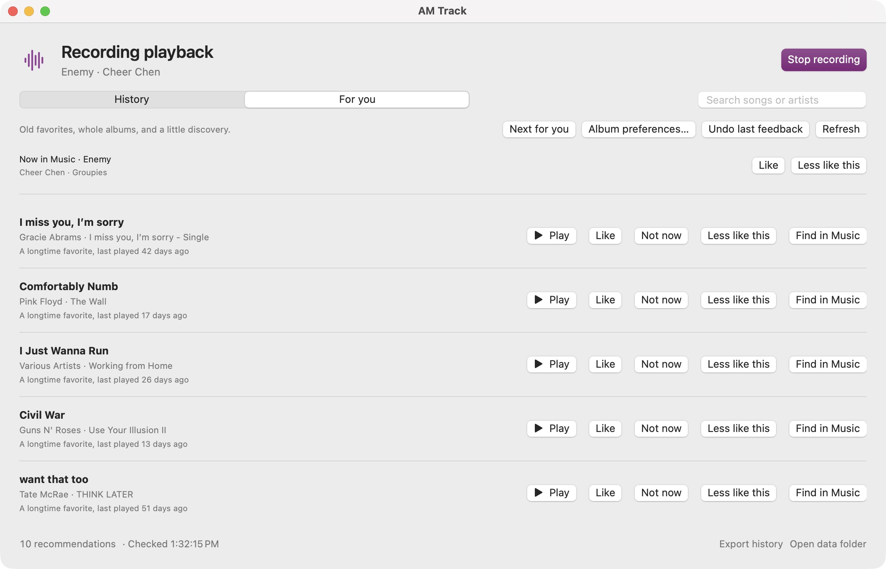
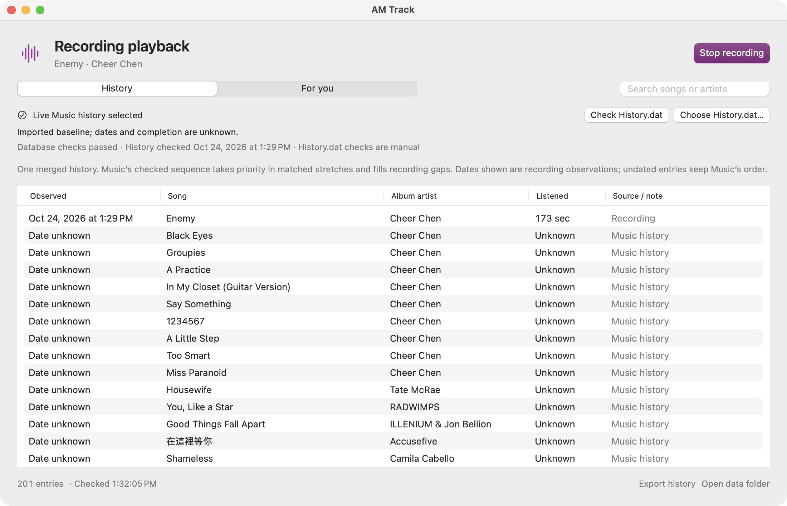
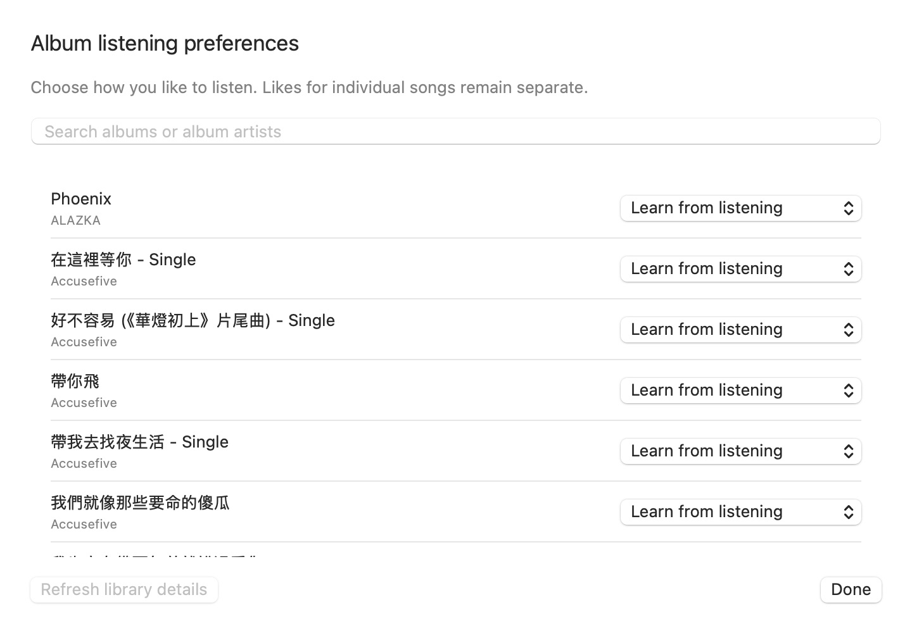

# AM Track

**记录听歌历史，重新发现 Music 资料库里的音乐。**

[English](README.md) | 简体中文

AM Track 是一款原生 macOS 菜单栏应用，记录你在 Music 中播放的音乐，帮你决定下一首听什么。你可以查看听歌历史、重听老歌、按顺序播放已收藏的专辑曲目，也可以让推荐歌曲接着播放。历史记录和偏好都保存在你的 Mac 上。

[下载测试版](https://github.com/Jichuan14/am-tracker/releases) · [安装说明（英文）](INSTALL.txt) · [更新记录（英文）](RELEASE-NOTES.md)



## 功能介绍

### 回看听歌历史

开启记录后，AM Track 会在 Music 播放时保存歌曲和实际观察到的收听时长。你可以按歌曲或艺人搜索，查看每条记录的来源，并将历史导出为 CSV。

你也可以手动检查 Music 的 `History.dat`，补充未开启记录时遗漏的歌曲。AM Track 会对齐匹配的播放序列，将其合并为一份历史；无法确定的日期和收听时长会保留为未知。资料库中的播放次数用于推荐，不会被转换成虚构的逐次播放记录。



### 找到想再听一次的音乐

**For you** 从你已收藏的资料库中推荐歌曲和专辑，结合听歌历史、资料库播放次数、近期收听和偏好反馈，让老歌与较少播放的音乐重新出现在你面前。每条推荐都有简短理由，已知在最近 24 小时内播放过的歌曲会被排除。

| 控件 | 作用 |
| --- | --- |
| **Play** | 在 Music 中播放选中的歌曲。 |
| **Like** | 明确表达对歌曲或专辑的喜爱；播放本身不会自动标记喜欢。 |
| **Not now** | 暂时隐藏这条推荐，持续 24 小时。 |
| **Less like this** | 隐藏该项目，并降低元数据相似的音乐的推荐权重。 |
| **Undo last feedback** | 撤销最近一次评分或专辑收听偏好修改。 |
| **Find in Music** | 在 Music 中打开搜索。 |

你也可以在菜单栏或 **For you** 中评价当前歌曲，或在 **History** 中右键点击歌曲进行评价。

### 按自己的习惯听专辑

打开 **Album preferences…**，为每张专辑选择 **Learn from listening**（根据收听学习）、**Prefer whole album**（偏好整张专辑）或 **Prefer individual songs**（偏好单曲）。自动学习会识别多次整专收听，单曲的喜欢标记则单独保留。

当专辑出现在推荐中时，点击 **Play album**，即可按碟号和曲目顺序播放你已收藏的歌曲。播放范围是已收藏的曲目，可能并不包含完整发行版本。



### 让下一首准备好

**Next for you** 会在 Music 队列末尾加入一首推荐歌曲，不打断当前播放。自动队列会提前准备后续选择，并在监测到播放推进时补入一首。播放推荐也会开启此功能；播放专辑时，会等到专辑后的推荐歌曲开始播放，再继续补充。

点击 **Stop auto queue** 可停止后续添加，已经排入队列的歌曲会保留。添加在后台完成，无需切换到 Music，也不需要辅助功能权限。

### 从菜单栏操作

无需打开主窗口，就能查看当前歌曲、开始或停止记录、表达偏好以及播放推荐。关闭窗口后，AM Track 仍会运行；退出应用才会停止。再次打开时，应用会记住你的记录开关选择。

## 开始使用

可下载的测试版支持 **macOS 13 及以上的 Apple Silicon Mac**，使用 macOS 自带的 Music 应用。下载版无需安装开发工具。

1. 从 [Releases](https://github.com/Jichuan14/am-tracker/releases) 下载应用 ZIP，解压后将 **AM Track.app** 移到“应用程序”。
2. 打开 AM Track 和 Music，选择 **Enable recording**，并在系统提示时允许 AM Track 控制 Music。选择 **Not now** 则暂不开启 Music 访问和记录。
3. 播放音乐以积累历史，再到 **For you** 查看推荐。请先将歌曲收藏到 Music 资料库；资料库为空或收听信息不足时，推荐可能暂时为空。

测试版使用临时签名，**尚未经过 Apple 公证**。如果 macOS 阻止打开，且你信任下载来源，可前往“系统设置 > 隐私与安全性”，为 AM Track 选择“仍要打开”。详见[安装说明（英文）](INSTALL.txt)。

## 数据保存在本机

AM Track 在本地保存听歌历史、资料库元数据和偏好反馈，不上传这些数据，也不发送分析数据。Music 本身可能会连接 Apple 服务以播放音乐。

新安装默认使用 `~/Library/Application Support/AM Track/`。如果应用旁已有数据库，或之前选择过数据文件夹，也可能使用该位置。点击 **Open data folder** 可查看实际位置；**Export history** 会生成 `history.csv`。备份数据文件夹前，请先退出 AM Track。

启用 Music 访问后，即使停止记录，资料库元数据和播放控件仍可刷新。记录仅覆盖本机，要求应用正在运行且 Mac 处于唤醒状态；不会收集其他设备的播放，也不会安装登录启动项。

队列添加依赖已验证的曲库 ID 和 macOS 私有播放接口。部分曲目，包括缺少此类 ID 的本地导入歌曲，无法通过该方式加入队列；macOS 更新也可能影响兼容性。目前推荐范围是你已收藏的资料库。

## 从源码构建

项目使用 Swift、SwiftUI、SQLite 和 JavaScript for Automation，需要 macOS 13 及以上及 Xcode Command Line Tools。

```sh
./app-source/build.sh
open "app-source/.build/AM Track.app"
```

脚本会编译应用、添加本地签名并运行隔离检查。源码结构和测试版打包方式见[开发说明（英文）](docs/DEVELOPMENT.md)。
