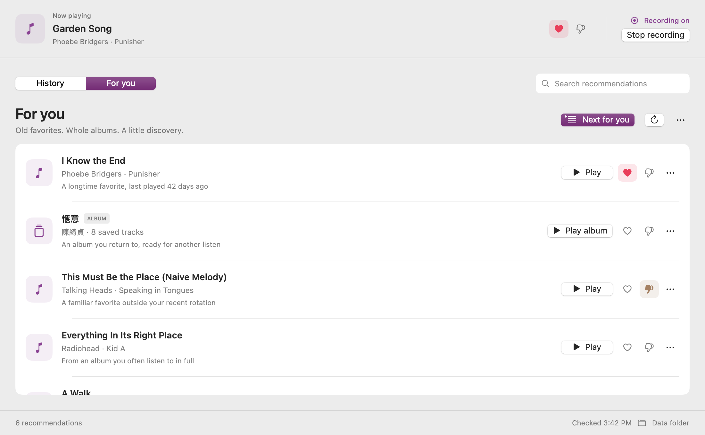
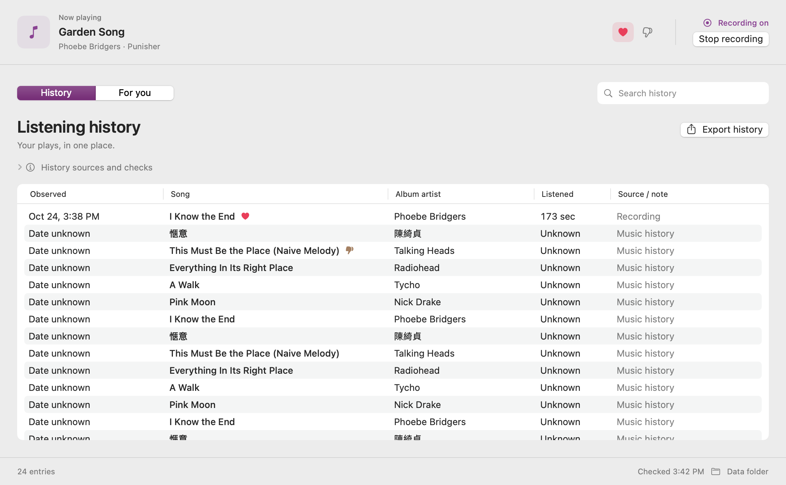
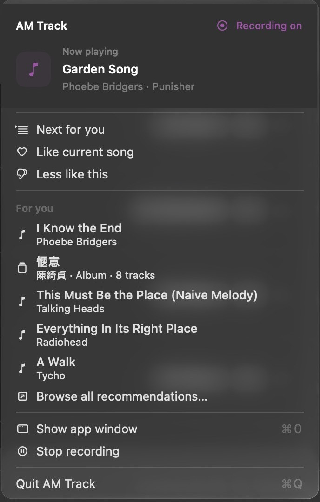

# Interface verification

The redesign is implemented in this source repository. Production views read
the existing live model. Screenshots below use the explicit design preview's
synthetic data, never a personal listening archive.

## Reviewed surfaces

- Window: one playback summary shared across History and For you; recording
  status is separate from playback. Native system type and accent color.
- Recommendations: clearer song / artist / reason hierarchy, media-type marks,
  one continuous list, and Play, Like, and More actions.
- History: expanding native table, search, export, and an inline disclosure for
  source details and manual History.dat checks. Warnings remain visible.
- Dropdown: playback heading, native commands, a scrollable full recommendation
  batch in a five-row viewport, separate title and artist lines, recording, and Quit.
- Native menu section headers on macOS 14+, with a disabled-label fallback
  on macOS 13. Recommendation identity remains stable while the menu is open.

## Verification performed

- `./app-source/build.sh`: debug build, local signing, and the full existing
  history, consent, recommendation, rotation, migration, playback, queue, and
  bundled-script checks pass. Tests use mocked Music calls.
- Native SwiftUI views rendered at 1100 × 680, 888 × 680, 1100 × 462, and
  888 × 462 content points in both Aqua and Dark Aqua. The minimum content
  height corresponds to the 490-point minimum window including its title bar.
- Empty recommendations, recording off, and short-window setup rendered.
- Live native preview: History / For you navigation, search filtering, Clear
  search, zero-results copy and count, row action menus, history disclosure,
  dropdown arrow-key navigation in both appearances, native section header
  skipping, and selected song contrast inspected.
- English, Chinese, album rows, and a long English song title included.
- No production Music playback or queue changes were needed for this UI check.

The compiler reports existing Swift 6 isolation warnings in the playback model;
the project builds in its configured Swift 5 mode. This change does not alter
those playback implementations. Visual verification was on the available Mac;
the macOS 13 fallback was compiled against the supported deployment target,
not exercised on a separate macOS 13 machine.

## Previews

### For you

### History

### Dropdown

## Reproduce

Follow [Interface and design previews](DEVELOPMENT.md#interface-and-design-previews).
The complete render matrix is generated in the ignored build folder. To change
the look, edit `Interface.swift`; see [the design rules](../DESIGN.md). There is
no placeholder content to replace in production: the real model supplies songs,
albums, history, recording state, and errors.

## Song preference states

Like now acts as a momentary feedback action. Its heart and song-specific Undo
receipt appear for three seconds, then clear while the stored recommendation
preference remains. Saved likes do not leave hearts in history, recommendation
subtitles, or current-song menu commands. Less like this retains its selected
state. Repeated Like clicks send feedback rather than toggling the preference.
The preview includes `like-before`, `like-confirmation`, and `like-after` frames
and checks that expiry preserves the saved Like.

## Dropdown width and material regression

The dropdown remains 340 pt wide with long English/CJK status messages, errors,
and recommendation titles. Display text reserves native state, icon and shortcut
columns; full identities and tooltips remain available. The header is transparent
and inherits the native menu material. `menuLayoutTests` exercises the real menu
builder and native width calculation. The check failed at 416 pt before the fix
and passes at 340 pt after it. Native dropdowns were inspected in both Aqua and
Dark Aqua after rebuilding, with no opaque header rectangle.

### Solid menu background

The menu heading now configures native menu material to use the opaque
window-background material and within-window blending when attached. Selection
materials remain native. This follow-up is checked by build and automated
material/width assertions only; no visual inspection was performed, as requested.
